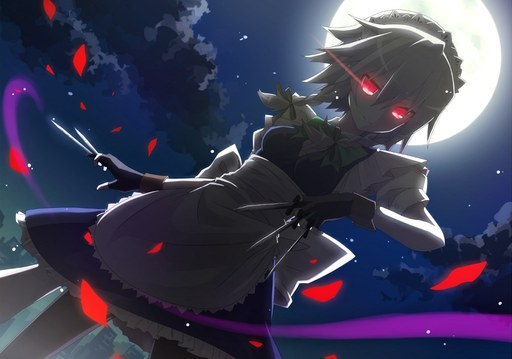

# Night of Knights



Тема для [Next Music](https://github.com/Web-Next-Music/Next-Music-Client) в стиле фона osu! карты
[beatMARIO - Night of Knights](https://osu.ppy.sh/beatmapsets/352570#osu/776951).

- Сакуя под луной на весь центральный блок, при прокрутке арт уезжает вместе со страницей.
- Палитра карты: ночной синий, лунный белый, алые лепестки.
- Apple-like liquid glass: сайдбар и плеер преломляют фон по краям, меню и очередь в стекле.
- Глаза Сакуи светятся от всего спектра музыки и вспыхивают на атаках.
- Старый интерфейс: классическая «Моя волна» и плеер на всю ширину окна.
- Логотип и название темы в заголовке окна, полноэкранный плеер, очередь и текст песни в стиле темы.

## Установка

Одной командой в PowerShell:

```powershell
& ([scriptblock]::Create((irm https://raw.githubusercontent.com/absolute2007/next-music-themes/main/install.ps1))) -Name 'Night of Knights'
```

Установщик закроет Next Music, положит тему в `%APPDATA%\next-music\Addons\Night of Knights`
вместе с картинками и флагами старого интерфейса, отключит другие темы и запустит клиент снова.

Вручную: скопируйте папку `Night of Knights` в `%APPDATA%\next-music\Addons\` и перезапустите
Next Music. Имя папки не меняйте: по нему загружаются картинки темы.

Чтобы выключить тему, переименуйте папку в `!Night of Knights` и перезапустите клиент.

## Реакция на музыку

Светятся сами глаза Сакуи, а питает их весь спектр: 32 логарифмические полосы
от 40 Гц до 16 кГц, каждая нормируется отдельно. Низы раздувают свечение вокруг
зрачков, середина делает ярче радужку и блик, верха дают искры, а атаки в любой
полосе вызывают вспышку.

Звук тема берёт сама: текущий `<audio>` из API Next Music сразу при запуске.
Если в настройках клиента включён **Visualizer**, используется его анализатор.
Без звука глаза тихо тлеют.

## Файлы

| Файл | Что делает |
| --- | --- |
| `style.css` | палитра, стекло, раскладка старого интерфейса |
| `script.js` | сцены с артом, анализ звука, преломление, логотип, оверлейный скроллбар |
| `experiments.override` | включает старый интерфейс (`WebNextNewWaveTab = "default"` и связанные флаги) |
| `assets/sakuya.jpg` | фон карты без чёрных полос |
| `assets/sakuya-eyes.png` | маска глаз для свечения |
| `assets/logo.svg` | логотип темы |

Арт принадлежит его автору; фон взят с карты osu! beatmapset 352570.
